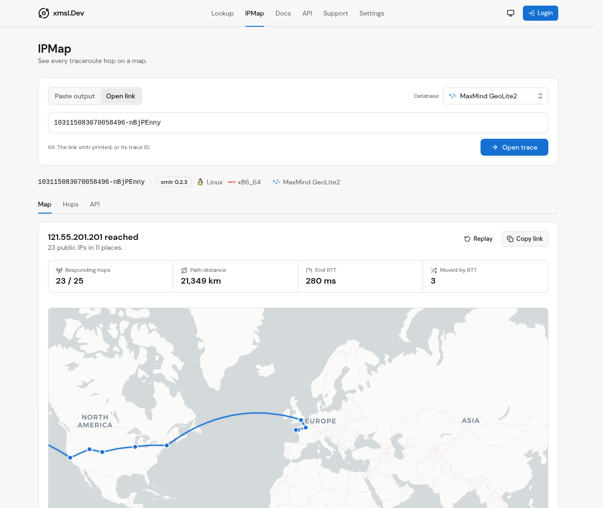

<h1 align="center">xmtr</h1>

<p align="center">
  Trace several targets at once and see every hop on a map.
</p>

<p align="center">
  <a href="https://github.com/Alice39s/xmtr/releases/latest"></a>
  <a href="https://github.com/Alice39s/xmtr/actions/workflows/release.yml"></a>
  
</p>

`xmtr` runs concurrent traceroutes with [trippy](https://github.com/fujiapple852/trippy), stops each route as soon as its path is stable, and uploads the result to [xmsl.dev IPMap](https://xmsl.dev/ipmap). IPMap places every hop on a map and replays the route.

<a href="https://xmsl.dev/ipmap?plat=xmtr&trace-id=103115083070058496-nBjPEnny"></a>

xmtr prints each route and the link to its map:

```text
$ sudo xmtr --min-rounds 20 121.55.201.201
121.55.201.201 -> 121.55.201.201 [ICMP IPv4] 20 rounds, 20.4s, reached
┌─────────────────────────────────────────────────────────────────────────────────────────────────────────────────────────────────────────┐
│ Hop   Host                                                               ASN        Loss%   Snt    Last     Avg    Best    Wrst   StDev │
╞═════════════════════════════════════════════════════════════════════════════════════════════════════════════════════════════════════════╡
│   1   dgw.vyme.net (45.88.180.254)                                       AS199297     0.0    20     0.4     0.4     0.3     0.9     0.1 │
│   2   te0-0-0-2.nr61.b074095-0.rns01.atlas.cogentco.com (149.6.72.106)   AS174        0.0    20     1.3     1.1     0.8     1.6     0.2 │
│   3   be2928.rcr51.rns01.atlas.cogentco.com (154.25.12.25)               AS174        0.0    20     1.5     1.6     1.5     2.0     0.1 │
│   4   be7070.rcr61.uro01.atlas.cogentco.com (154.54.76.85)               AS174        0.0    20     6.0     5.7     5.5     6.1     0.2 │
│   5   be2480.ccr42.par01.atlas.cogentco.com (130.117.3.13)               AS174        0.0    20     7.3    10.9     7.0    44.4    11.2 │
│   6   port-channel2732.ccr92.lhr01.atlas.cogentco.com (154.54.75.138)    AS174        0.0    20    14.1    14.1    14.0    14.5     0.1 │
│   7   be3467.ccr32.bos01.atlas.cogentco.com (154.54.94.45)               AS174        0.0    20    76.4    76.3    76.2    76.5     0.1 │
│   8   be8030.ccr22.alb02.atlas.cogentco.com (154.54.169.226)             AS174        0.0    20    79.9    79.9    79.7    80.6     0.2 │
│   9   port-channel8023.ccr92.cle04.atlas.cogentco.com (154.54.169.197)   AS174        0.0    20    87.4    87.5    87.3    87.6     0.1 │
│  10   be2718.ccr42.ord01.atlas.cogentco.com (154.54.7.129)               AS174        0.0    20    99.3    99.0    98.8    99.3     0.1 │
│  11   be5068.ccr32.oma02.atlas.cogentco.com (154.54.166.73)              AS174        0.0    20   102.7   103.6   102.7   118.3     3.5 │
│  12   be8568.ccr82.den01.atlas.cogentco.com (154.54.95.109)              AS174       70.0    20   114.7   114.2   113.8   114.7     0.3 │
│  13   be9563.ccr82.slc03.atlas.cogentco.com (154.54.163.206)             AS174       55.0    20   125.1   124.5   123.5   125.1     0.7 │
│  14   be3906.ccr22.sfo01.atlas.cogentco.com (154.54.5.154)               AS174        0.0    20   138.5   138.6   138.5   138.9     0.1 │
│  15   be3670.ccr41.sjc03.atlas.cogentco.com (154.54.43.14)               AS174        0.0    19   140.7   140.6   140.4   140.8     0.1 │
│  16   38.104.138.31                                                      AS174        0.0    19   140.0   140.1   139.8   140.3     0.1 │
│  17   tky009bb10.IIJ.Net (58.138.88.225)                                 AS2497      73.7    19   240.2   241.9   240.2   242.9     1.1 │
│  18   tky009ix55.IIJ.Net (58.138.112.109)                                AS2497       0.0    19   241.4   241.3   241.2   241.4     0.1 │
│  19   210.173.173.82                                                     -            0.0    19   239.1   239.0   238.9   239.2     0.1 │
│  20   198.81.233.103.guam.net (198.81.233.103)                           AS3605       0.0    19   235.2   235.3   235.0   235.5     0.1 │
│  21   202.128.5.115.guam.net (202.128.5.115)                             AS3605       0.0    19   270.3   270.2   270.0   270.7     0.2 │
│  22   ae14-cgw-har-gu.guam.net (198.81.233.92)                           AS3605       0.0    19   264.4   264.5   264.1   266.4     0.5 │
│  23   ???                                                                -          100.0    19       -       -       -       -       - │
│  24   ???                                                                -          100.0    19       -       -       -       -       - │
│  25   121-55-201-201.d.c200.guam.net (121.55.201.201)                    AS3605       0.0    19   283.7   282.6   279.6   285.2     1.9 │
└─────────────────────────────────────────────────────────────────────────────────────────────────────────────────────────────────────────┘

trace-id 103115083070058496-nBjPEnny
https://xmsl.dev/ipmap?plat=xmtr&trace-id=103115083070058496-nBjPEnny
```

The trace ID is the snowflake ID and an 8-letter key. Anyone with the link can open the trace; the key keeps others from guessing it.

## Install

**macOS, Linux, FreeBSD, Termux**

```sh
curl -fsSL https://raw.githubusercontent.com/Alice39s/xmtr/main/install.sh | bash
```

The script is POSIX `sh`, so `| sh` works on systems without bash, such as OpenWrt. As a regular user it installs into `/usr/local/bin` through `sudo`, so `sudo xmtr` finds the binary; sudo may ask for your password. Without sudo rights it installs into `~/.local/bin`.

**Windows**

```powershell
powershell -c "irm https://raw.githubusercontent.com/Alice39s/xmtr/main/install.ps1|iex"
```

The script picks the build for your system, checks it against the release `SHA256SUMS`, and runs a small installer that places a single `xmtr` binary and then deletes itself. Nothing else is written, except the user `PATH` entry on Windows. Downloads use HTTPS, unless `XMTR_RELEASES` names an `http://` mirror.

| Default location | |
| --- | --- |
| Linux, macOS, FreeBSD | `/usr/local/bin`; `~/.local/bin` without sudo rights |
| Termux | `$PREFIX/bin` |
| Windows | `%LOCALAPPDATA%\Programs\xmtr` |

Pass installer options after `bash -s --`:

```sh
curl -fsSL https://raw.githubusercontent.com/Alice39s/xmtr/main/install.sh | bash -s -- --dir ~/bin --version v0.2.6
```

`XMTR_INSTALL_DIR` sets the directory, and `XMTR_RELEASES` points both the script and the installer at a mirror of the releases page; on Windows these two variables are the only way to pass options. Archives for manual installs are on the [releases page](https://github.com/Alice39s/xmtr/releases). Releases are immutable: once published, their files and tag cannot change. Check a downloaded file with `gh release verify-asset <tag> <file> --repo Alice39s/xmtr`, and its [build provenance](https://github.com/Alice39s/xmtr/attestations) with `gh attestation verify <file> --repo Alice39s/xmtr`.

**Update or remove**

```sh
xmtr self update        # install the latest release over this binary
xmtr self uninstall     # delete this binary
```

**Package managers**

| | Manager | Command |
| :-: | --- | --- |
|  | Homebrew (macOS, Linux) | `brew install alice39s/tap/xmtr` |
|  | Scoop (Windows) | `scoop bucket add alice39s https://github.com/Alice39s/scoop-bucket` then `scoop install alice39s/xmtr` |
|  | WinGet (Windows) | `winget install Alice39s.xmtr` |
|  | Chocolatey (Windows) | `choco install xmtr` |
|  | npm | `npm install --global @xmtr/cli`, or `npx @xmtr/cli 1.1.1.1` |
|  | PyPI | `uv tool install xmtr`, `pipx install xmtr` or `pip install xmtr` |
| <picture><source media="(prefers-color-scheme: dark)" srcset=".github/assets/rust-dark.svg"></picture> | Cargo | `cargo binstall xmtr` for the release binary, or `cargo install xmtr` to build it |
|  | mise | `mise use --global github:Alice39s/xmtr` |
|  | Nix | `nix run github:Alice39s/xmtr -- 1.1.1.1`, or `nix profile install github:Alice39s/xmtr` |
|  | Docker | `docker run --rm ghcr.io/alice39s/xmtr 1.1.1.1` |

The npm package and the PyPI wheels hold the same binaries as the release archives; npm picks the `@xmtr/<platform>` package for your system. The Docker image holds only the static binary and is built for amd64, arm64, armv7, armv6, 386, riscv64 and loong64. Docker grants raw sockets to containers by default; with Podman add `--cap-add NET_RAW`.

**Linux package repositories**

The deb, rpm and apk packages install `/usr/bin/xmtr` and grant it raw sockets with `setcap`, so every user can trace without root. They are attached to each release and served from signed repositories:

| | System | Architectures |
| :-: | --- | --- |
|  | Debian, Ubuntu | amd64, arm64, armhf, i386, riscv64, loong64 |
|  | Fedora, RHEL | x86_64, aarch64, armv7hl, i686, riscv64, loongarch64 |
|  | Alpine | x86_64, aarch64, armv7, armhf, x86, riscv64, loongarch64 |

```sh
# Debian, Ubuntu
sudo curl -fsSL -o /usr/share/keyrings/xmtr.gpg https://alice39s.github.io/xmtr/xmtr.gpg
echo "deb [signed-by=/usr/share/keyrings/xmtr.gpg] https://alice39s.github.io/xmtr/deb stable main" | sudo tee /etc/apt/sources.list.d/xmtr.list
sudo apt update && sudo apt install xmtr

# Fedora, RHEL
sudo curl -fsSL -o /etc/yum.repos.d/xmtr.repo https://alice39s.github.io/xmtr/rpm/xmtr.repo
sudo dnf install xmtr

# Alpine
wget -qO /etc/apk/keys/xmtr.rsa.pub https://alice39s.github.io/xmtr/apk/xmtr.rsa.pub
echo https://alice39s.github.io/xmtr/apk >> /etc/apk/repositories
apk add xmtr
```

The repositories are signed with the keys in [`packaging/keys`](packaging/keys). The release workflow publishes every channel above except mise and Nix, which read the GitHub release and the flake directly. Update packages installed this way with their manager rather than `xmtr self update`.

## Platforms

All builds are cross-compiled on Linux. Before each release, CI runs every build and traces `127.0.0.1` with it. x86_64 and ARM64 builds for Linux, macOS and Windows run on hosted runners. The other Linux CPUs run under QEMU user emulation. FreeBSD runs in a virtual machine, and Android runs in the Termux image. After a release, CI installs xmtr through each package channel on Linux, macOS and Windows runners.

| | System | Architectures |
| :-: | --- | --- |
|  | Linux, glibc and musl |  x86_64 ·  i686 ·  aarch64, armv7, armv6 ·  riscv64 ·  loongarch64 |
|  | Linux, glibc |  powerpc64le, powerpc64, s390x ·  sparc64 |
| <picture><source media="(prefers-color-scheme: dark)" srcset=".github/assets/apple-dark.svg"></picture> | macOS |  Apple silicon ·  x86_64 |
|  | Windows 10 and later |  x86_64 ·  i686 ·  ARM64 |
|  | FreeBSD |  x86_64 |
|  | Android, Termux with root |  aarch64, armv7 ·  x86_64 ·  i686 |

Not available:

| | System | Reason |
| :-: | --- | --- |
|  | NetBSD | trippy's socket layer does not compile there |
|  | OpenBSD, DragonFly BSD | Rust ships no prebuilt standard library for cross builds |
|  | illumos, Solaris | trippy's socket layer does not compile there |
|  | iOS, WebAssembly | no raw socket access for command-line programs |

## Privileges

Tracing needs raw sockets.

| System | Run as |
| --- | --- |
| Linux | root, or once: `sudo setcap cap_net_raw+ep $(command -v xmtr)`; the deb, rpm and apk packages do this at install |
| macOS | any user; ICMP and UDP use unprivileged sockets, TCP needs root |
| Windows | an Administrator terminal |
| FreeBSD, Android | root |

`xmtr self update` replaces the binary, so run `setcap` again after an update.

## How a run works

1. Every target is resolved. A hostname with both A and AAAA records is traced over IPv4 and IPv6 at the same time, using the first address of each family in resolver order. A family without a local route is skipped.
2. Up to 8 routes run in parallel (`-j`). Each tracer has its own ICMP identifier, UDP source port and sequence range, so replies never mix between routes.
3. A route stops once it has run `--min-rounds` rounds, no new hop has appeared for 3 rounds, and the target answered. A route that never reaches its target gets 5 extra rounds. `--max-rounds` and `--time-limit` are hard limits; a tracer never runs more rounds than fit in the time limit.
4. With `--protocol auto`, a target that does not answer ICMP is traced again over TCP port 443, or UDP with unprivileged sockets. Both routes are uploaded. A route where no hop answered is reported as an error and left out.
5. Public hop addresses get reverse DNS names and origin AS numbers ([Team Cymru](https://www.team-cymru.com/ip-asn-mapping)), at most 32 lookups at a time. Private addresses are never sent to a resolver given with `--dns`.
6. The routes are uploaded to `--api`, and xmtr prints the trace ID and the IPMap link. `--pin 2580` adds a four-digit PIN (digits 0-8, no 4) that viewers must enter. `--no-upload` keeps everything local. `--hide-origin` asks the gateway not to store the public address the upload came from; the first hops may still show the network.

In a terminal, a panel below the prompt shows these steps as they run: which step is active, one progress bar per route, and how many reverse lookups have answered. The panel is drawn on stderr and erased before the route tables and the link are printed. Ctrl-C stops the run and exits with status 130. `--quiet`, or stderr that is not a terminal, turns the panel off.

## DNS

`--dns` selects the resolver for target names, the upload, reverse DNS and AS lookups.

| Value | Resolver |
| --- | --- |
| `auto` | system configuration; target names go through the OS, so hosts files apply |
|  `cloudflare`,  `google`,  `quad9`, `9.9.9.9`, `192.0.2.53:5353` | plain DNS over UDP and TCP |
| `tcp://[2620:fe::fe]` | DNS over TCP |
| `tls://[2606:4700:4700::1111]`, `dot://dns.quad9.net` | DNS over TLS |
| `https://cloudflare`, `doh://dns.google/dns-query` | DNS over HTTPS |
| `quic://dns.adguard-dns.com` | DNS over QUIC |

`cloudflare`, `google` and `quad9` also work as the host of a URL and include both IPv4 and IPv6 servers. A hostname in a URL is looked up once with the system resolver; certificates are checked against public roots. DNS over HTTPS needs a hostname or an IPv4 address.

## Options

```text
Usage: xmtr [OPTIONS] <TARGET>...
       xmtr self <update|uninstall>

-p, --protocol <auto|icmp|udp|tcp>   probe protocol (default auto)
-4, --ipv4 / -6, --ipv6              trace one family only
    --min-rounds <N>                 rounds before a route may stop (default 5)
-c, --max-rounds <N>                 hard limit on rounds (default 30)
-t, --time-limit <DURATION>          time limit per route, at least 1s (default 45s)
-i, --interval <DURATION>            minimum time between rounds, at least 100ms (default 1s)
-m, --max-ttl <N>                    maximum TTL (default 30)
    --port <PORT>                    TCP destination port (default 443)
-j, --parallel <N>                   routes traced at the same time
-u, --unprivileged                   unprivileged sockets (macOS)
    --dns <RESOLVER>                 see DNS above (default auto)
    --no-rdns                        skip reverse DNS and AS lookups
    --no-upload                      print the routes only
    --hide-origin                    ask the gateway not to store the sender address
    --pin <PIN>                      four digits from 0-8 without 4
    --api <URL>                      upload gateway, also XMTR_API
    --json                           print the upload payload on stdout, tables on stderr
-q, --quiet                          print only the IPMap link
```

## Build from source

```sh
cargo build --release --workspace
```

The workspace builds `xmtr` and `xmtr-installer`. `nix build` builds `xmtr` from the flake. Release builds use [cargo-zigbuild](https://github.com/rust-cross/cargo-zigbuild) for Linux, Windows and macOS, [cross](https://github.com/cross-rs/cross) for FreeBSD, powerpc64 and sparc64, and [cargo-ndk](https://github.com/bbqsrc/cargo-ndk) for Android; see `.github/workflows/release.yml`. The workspace builds against a patched trippy-core in `vendor/` that traces IPv4 on Android; see [vendor/README.md](vendor/README.md).

## License

Licensed under either of [Apache License 2.0](LICENSE-APACHE) or [MIT](LICENSE-MIT), at your option.
